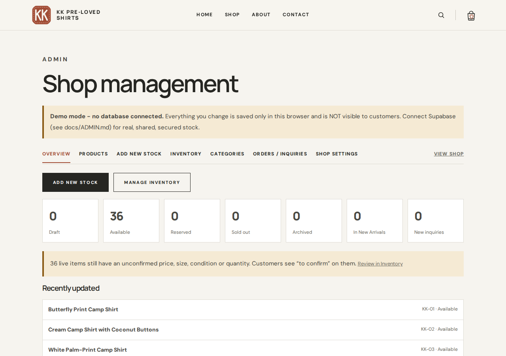
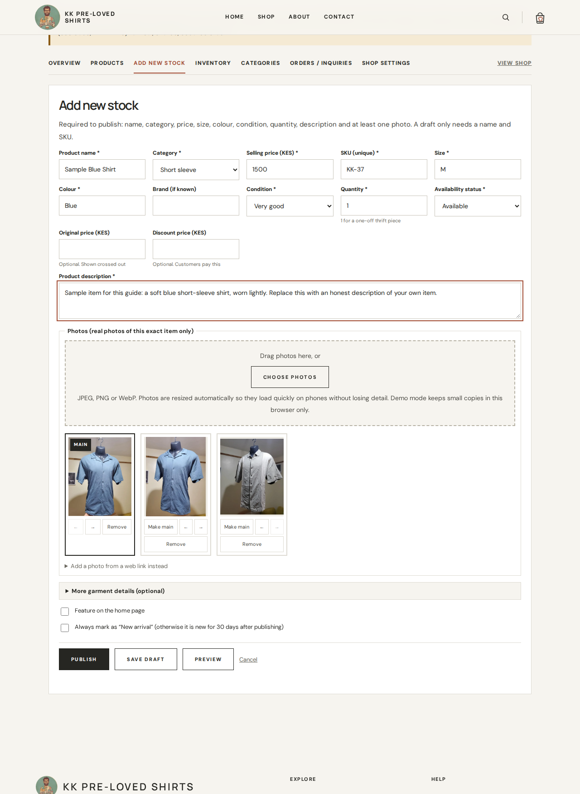
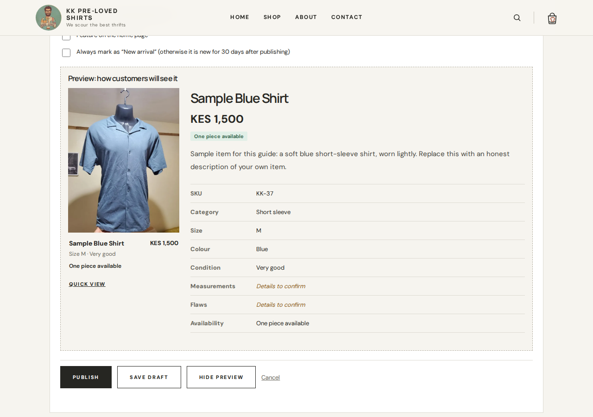
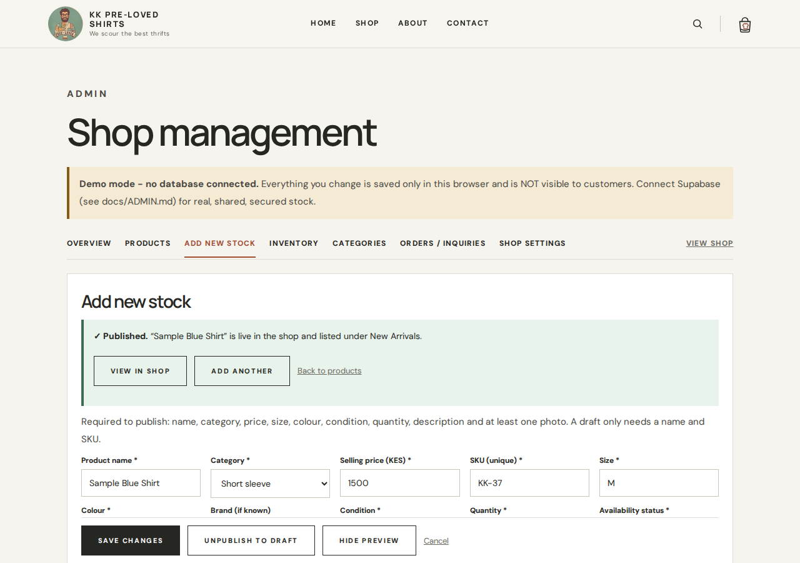
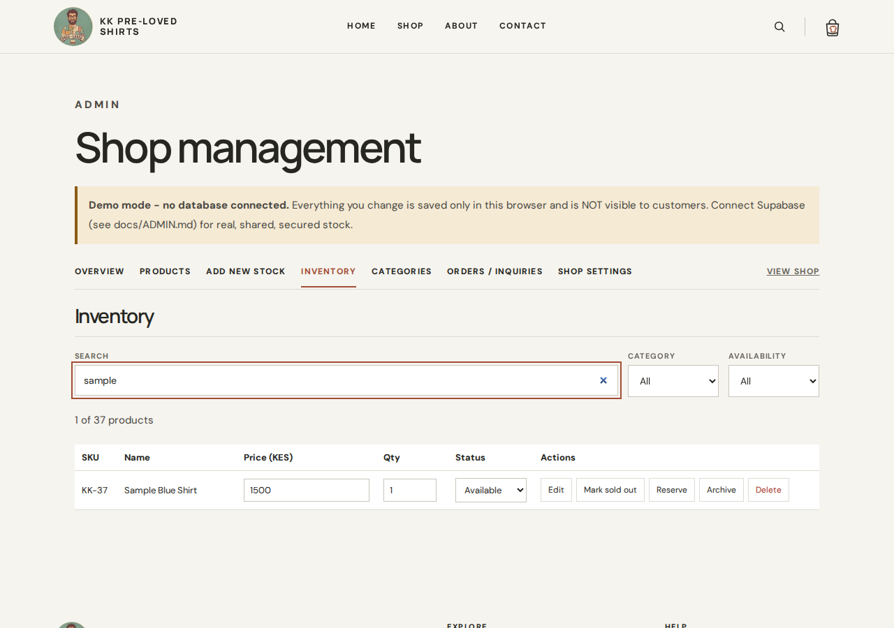
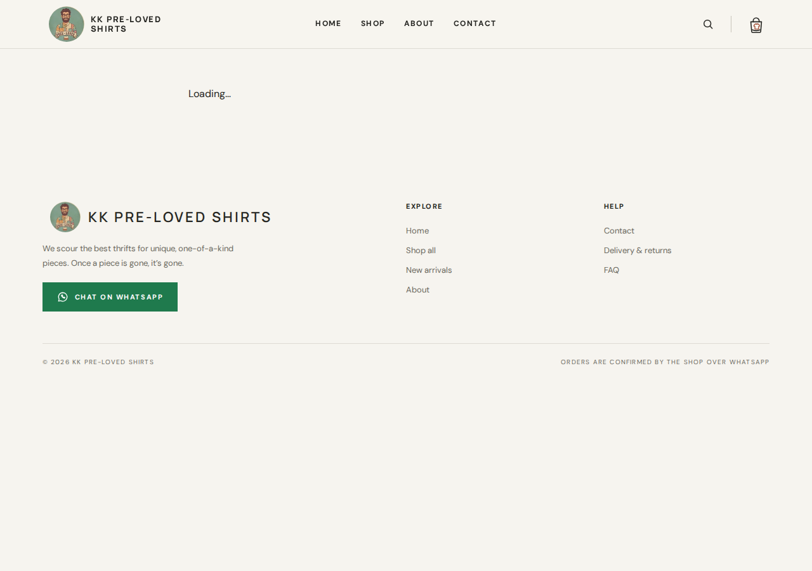
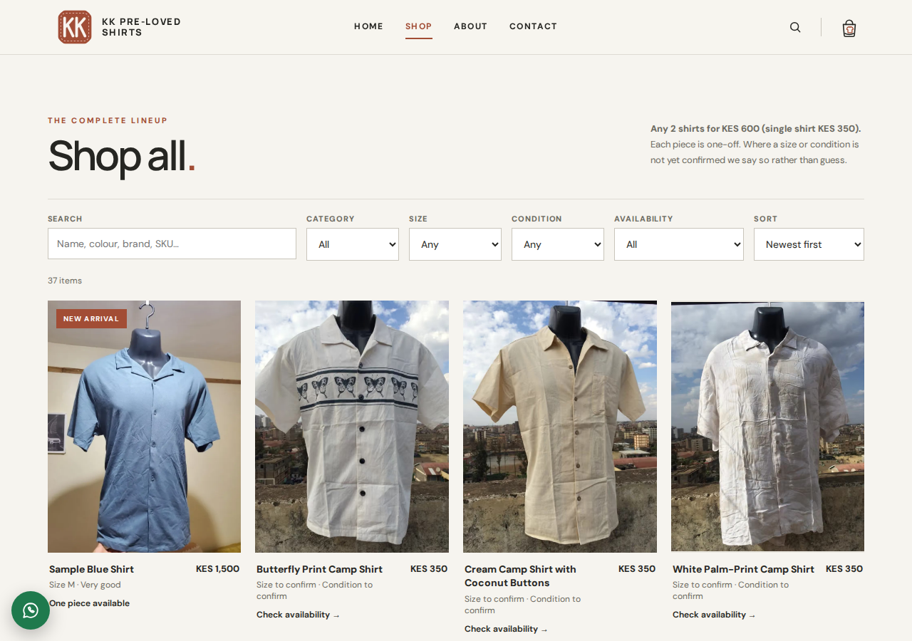
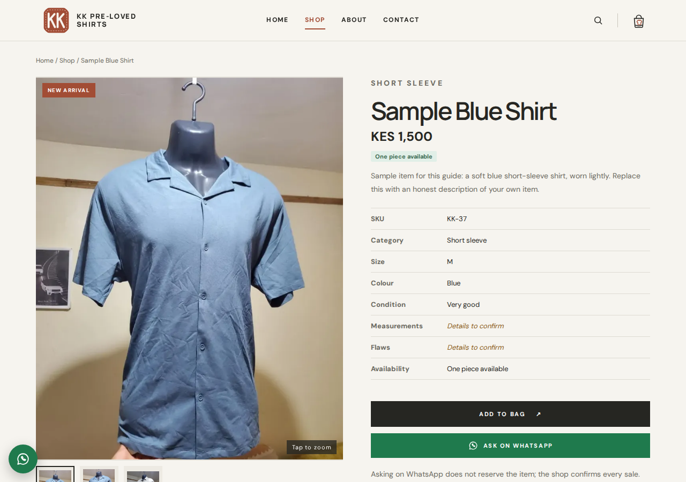
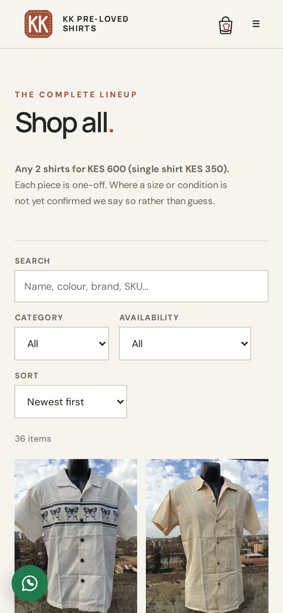

# How to add and manage stock

This guide is for the shop owner. You do not need to touch any code. Everything is done from the **Shop management** page of your website, in your phone's or computer's browser.

> The site must be connected to its database first (a one-time setup done by your developer, see `docs/ADMIN.md`). Until then the admin page shows a yellow **Demo mode** banner, and anything you change is saved only in that browser and customers will **not** see it. If you see that banner on the live website, tell your developer.

---

## 1. Log in

1. Open your website and add `/admin` to the end of the address, for example `yourshop.co.ke/admin`.
2. Type your **Email** and **Password**, then press **Sign in**.
3. You will see the menu: **Overview · Products · Add New Stock · Inventory · Categories · Orders / Inquiries · Shop Settings**.

If you are told "this account is not an admin", the owner account has not been added yet. Ask your developer.

> **About the screenshots in this guide.** They were taken from the real running site in **demo mode** (no database connected), which is why the yellow "Demo mode" banner shows and why the sign-in step has no picture: the sign-in form only appears once the live database is connected. The example item is a made-up sample, not part of the shop's stock. Your own screens look the same, without the yellow banner.

---

## 2. Add a new item

1. Choose **Add New Stock**.
2. Add the **photos** first (see section 3).
3. Fill in the details:

| Field | What to enter |
|---|---|
| **Product name** * | A plain description, e.g. "Navy blue checked long-sleeve shirt" |
| **Category** * | Pick from the list (you can add categories under **Categories**) |
| **Selling price (KES)** * | Numbers only, e.g. `1500`. Leave it blank only if the item should use the shop's standard price (KES 350, or 2 for KES 600). |
| **SKU (unique)** * | A short code for the item. The next free one (for example `KK-37`) is already filled in. Keep it or change it, but two items cannot share a code. |
| **Size** * | For example `M`, `L`, `42` |
| **Colour** * | For example `Navy blue` |
| **Brand (if known)** | Optional |
| **Condition** * | Choose from the list |
| **Quantity** * | **`1`** for a one-off thrift piece. Use more only if you really have several identical items. |
| **Availability status** * | Leave as is when publishing; it becomes **Available**. |
| **Product description** * | A few honest sentences: fit, fabric, anything customers should know |
| Original price / Discount price | Optional. Original is shown crossed out; Discount is what the customer pays. Discount must be lower than the price. |

`*` means required to publish. A **draft** only needs a name and SKU.

4. Optional: open **More garment details** to add measurements (cm, laid flat), flaws, or tick **Inspected: no flaws found**. Customers like this detail.
5. Tick **Feature on the home page** if you want the item shown on the home page.

---

## 3. Upload photos

- Press **Choose photos** (or drag photos onto the box). You can pick **several photos at once**.
- Use real photos of **that exact item**. Photos from a phone camera are fine: JPEG, PNG or WebP, up to 25 MB each. (iPhone photos saved as HEIC must be saved as JPEG first.)
- The website automatically makes three sizes (up to 1600 px on the long edge) so it loads fast on phones and still looks sharp when zoomed. - **Your original photo is kept safely too.** Below the photo box there is a tick box, **Also keep the original full-resolution photo**, switched on by default. The untouched original is stored privately: customers can never see or download it, and only you (signed in) can. To get it back, press **Original** under that photo. Photos added before this feature existed have no Original button. Originals use storage space (a few MB each), so untick the box for photos you do not need to keep.
- The **first photo is the main photo**, the one customers see in the shop. To change it, press **Make main** under another photo. Use **←** and **→** to reorder, and **Remove** to delete one.
- To **replace a photo** later, edit the item, **Remove** the old one and add the new one.

---

## 4. Preview, then publish

1. Press **Preview** to see exactly how customers will see the item. Press **Hide preview** to close it.
2. Press **Publish** to make it live, or **Save draft** to keep working on it later (customers will not see drafts).
3. A green message says **Published** and that the item is **listed under New Arrivals**. Press **View in shop** to see it.

New items appear on the shop and under **New arrivals** straight away. **There is nothing to deploy and no developer needed.** Items stay marked "New arrival" for 30 days after publishing, newest first. Customers can also find them with the shop search.

Use **Add another** to go straight to the next item.

---

## 5. Update stock later

Open **Inventory** for the quick table. You can **search** (name, SKU, colour, brand) and filter by **Category** and **Availability**.

| I want to… | Do this |
|---|---|
| Change a price | Click the **Price** box, type the new number, press **Enter** |
| Change a quantity | Click the **Qty** box, type the number, press **Enter** |
| Mark an item **sold out** | Press **Mark sold out** (quantity becomes 0) |
| **Reserve** an item for a customer | Press **Reserve** |
| Put a reserved or sold item back on sale | Change **Status** to **Available** (if the quantity was 0 it becomes 1) |
| Hide an item without deleting it | Press **Archive**. **Restore** brings it back. |
| Edit anything else (photos, description, size…) | Press **Edit** |
| Remove an item for good | Press **Delete**, then confirm. Archive is safer. |

Good to know:

- **A customer opening WhatsApp never changes your stock.** Stock only changes when you change it. After a customer confirms and pays the booking fee, mark the item **Reserved** or **Sold out** yourself.
- **Overview** shows a summary and the most recently added stock.
- **Orders / Inquiries** lists the WhatsApp inquiries customers started.

---

## 6. Change the WhatsApp, Instagram, TikTok and slogan

Open **Shop Settings**, change what you need, then press **Save settings**. Changes show on the website straight away.

| Setting | What to enter |
|---|---|
| **WhatsApp Business number or link** | Your number (for example `0712 345 678` or `+254712345678`) or a link like `https://wa.me/254712345678`. Customers' "Chat on WhatsApp" buttons will use this. Each product button includes the product name, size, price and link. |
| **Instagram link** | The full link to your profile, for example `https://www.instagram.com/youraccount` |
| **TikTok link** | The full link, for example `https://www.tiktok.com/@youraccount` |
| **Shop slogan** | Currently "We scour the best thrifts". Change the wording here whenever you like; leave it blank to show no slogan. |
| **Store announcement** | A short message shown in a bar at the top of every page (for example a holiday notice). Leave blank for none. |
| **Shop name, Contact email, Phone number for calls, Shop description** | Shown across the site and in the footer |
| **Logo** | **Upload a new logo** (square images work best). **Use the standard logo** goes back to the shop's standard KK logo. |

If you leave Instagram or TikTok blank, that icon is simply not shown. If a link is not valid, the page tells you what to fix.

---

## 7. If something goes wrong

| What you see | What it means |
|---|---|
| Red message under a field | Fix that field; the form tells you what is wrong |
| "Could not save. Please try again." | Check your internet, then press the button again. Nothing is lost on the page. |
| A photo is rejected | Use JPEG, PNG or WebP under 25 MB |
| "SKU already used" | Give the item a different code |
| Yellow **Demo mode** banner | The database is not connected; call your developer |

---

## 8. What your customers see

The new item appears first in the shop (newest first) with a **New arrival** tag, and has its own page with a photo gallery, zoom, details and an **Ask on WhatsApp** button that includes the item's name, size, price and link. First on a computer, then on a phone:

